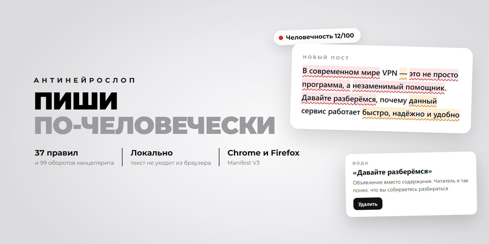
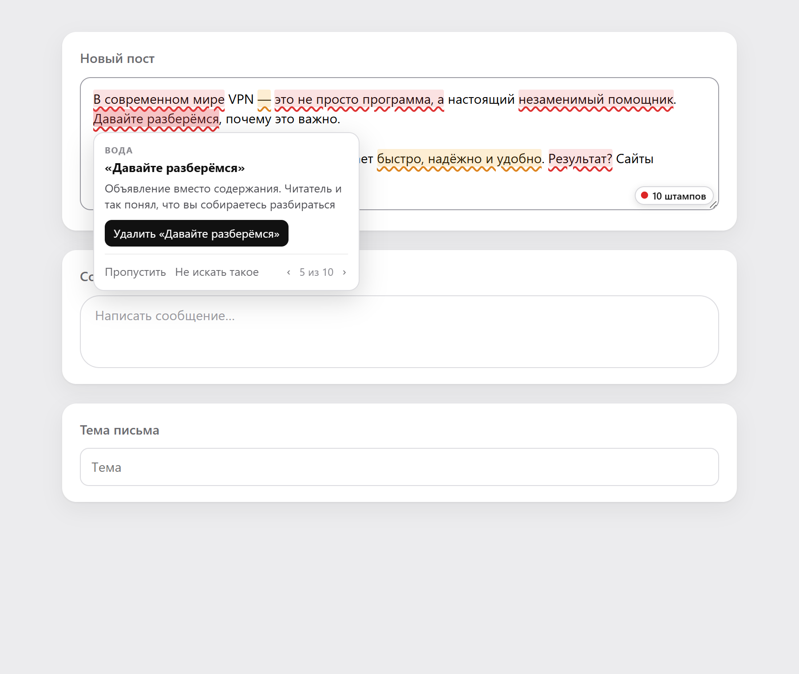
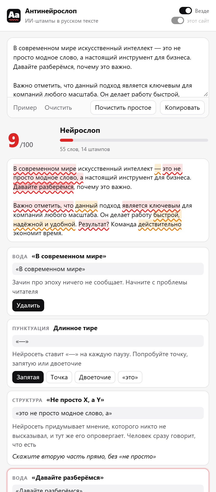

<p align="center">
  <a href="#установка"><b>Установка</b></a> &nbsp;|&nbsp;
  <a href="#что-ловит"><b>Что ловит</b></a> &nbsp;|&nbsp;
  <a href="#как-устроено"><b>Как устроено</b></a> &nbsp;|&nbsp;
  <a href="#english"><b>English</b></a>
</p>

---

Расширение для Chrome и Firefox. Пока вы пишете пост в Telegram Web, письмо в Gmail или комментарий во VK, оно подчёркивает фразы, по которым текст выдаёт нейросеть: «давайте разберёмся», «важно отметить», «это не просто X, а Y», «играет ключевую роль», длинные тире, канцелярит вроде «данный» и «осуществлять». Нажмите на подчёркнутое слово, и появится подсказка: почему это звучит как ИИ и чем заменить

Весь разбор идёт в вашей вкладке. У расширения нет сервера, оно не шлёт текст ни в какие API и не собирает статистику



## Окно разбора

Нажмите на иконку расширения, вставьте текст и получите оценку человечности от 0 до 100, подсветку и список находок с пояснениями. Кнопка «Почистить простое» сама уберёт вводные фразы, усилители, канцелярит и точки в конце коротких строк. Фразы вроде «не просто X, а Y» расширение только отмечает: переписать их по словарю нельзя, нужна ваша мысль



## Установка

Расширения пока нет в магазинах, его ставят из папки

**Chrome, Яндекс Браузер, Edge, Opera**

1. Скачайте репозиторий: зелёная кнопка Code → Download ZIP, и распакуйте
2. Откройте `chrome://extensions` и включите «Режим разработчика» в правом верхнем углу
3. Нажмите «Загрузить распакованное» и выберите папку с файлом `manifest.json`

**Firefox 128 и новее**

1. Откройте `about:debugging#/runtime/this-firefox`
2. «Загрузить временное дополнение» → выберите `manifest.json`

Firefox держит такое дополнение до перезапуска браузера. Подсветка в contenteditable (Telegram Web, Gmail) работает с Firefox 140, в обычных textarea раньше

## Что ловит

37 правил и словарь на 99 канцелярских оборотов. Идеи взяты из открытых списков ИИ-штампов (stop-slop Хардика Пандьи, [Wikipedia: Signs of AI writing](https://en.wikipedia.org/wiki/Wikipedia:Signs_of_AI_writing)) и переложены на русский язык

| Группа | Примеры |
|---|---|
| Структура | «это не просто X, а Y», «дело не в X, а в Y», «не потому что X. А потому что Y», «Результат?», «Секрет прост:», «быстро, надёжно и удобно», «Быстро. Просто. Удобно.» |
| Вода | «давайте разберёмся», «погрузимся в мир», «в современном мире», «важно отметить», «в этой статье мы рассмотрим», «и вот почему», «в заключение», «и это нормально», «Отличный вопрос!», «Надеюсь, это поможет» |
| Штампы | «раскройте потенциал», «на новый уровень», «незаменимый помощник», «играет ключевую роль», «сложно переоценить», инновационный, экосистема, синергия |
| Канцелярит | является, представляет собой, данный, осуществлять, на сегодняшний день, в связи с тем что, с целью, имеет возможность, принимать участие |
| Усилители | действительно, абсолютно, безусловно, по сути, «легко и просто», «интуитивно понятный» |
| Пунктуация | длинное тире, точка в конце короткой строки, «?!» и «!!!», эмодзи вместо пунктов, **жирный ярлык:** в каждом пункте |
| Ритм | все предложения одной длины |

Каждое правило объясняет, почему фраза звучит как нейросеть. Часть конструкций нормальна в живой речи, поэтому у любой находки есть «Пропустить» и «Не искать такое». Отключённые правила возвращаются в окне разбора

## Как устроено

```
manifest.json        Manifest V3, общий для Chrome и Firefox
src/rules.js         правила: регулярные выражения, словари, пояснения
src/engine.js        разбор текста, оценка, аккуратные замены
src/content.js       подсветка на страницах и подсказка по клику
popup/               окно разбора
tests/rules.test.js  примеры для каждого правила: где должно сработать и где нет
scripts/e2e.py       проверка в настоящем Chrome через Playwright
```

В textarea и input расширение кладёт поверх поля прозрачную копию текста и подчёркивает в ней штампы. В contenteditable (Telegram Web, Gmail, Threads) оно использует CSS Custom Highlight API: DOM страницы остаётся нетронутым, поэтому редакторы сайтов не ломаются. Замена идёт через `execCommand('insertText')`, так что работает Ctrl+Z

Расширение просит два разрешения: `storage` для настроек и `activeTab`, чтобы в окне показать, на каком сайте выключить подсветку

## Добавить правило

Правило в `src/rules.js` выглядит так:

```js
{
  id: 'davaite',
  cat: 'Вода',
  title: '«Давайте разберёмся»',
  why: 'Объявление вместо содержания. Читатель и так понял, что вы собираетесь разбираться',
  re: phr(['давайте', 'давай'], { tail: '\\s+(?:разбер[её]мся|рассмотрим|погрузимся)' }),
  fix: DEL,     // варианты замены, '' значит «удалить»
  weight: 3     // насколько сильно правило роняет оценку
}
```

Добавьте рядом примеры в `tests/rules.test.js`: фразы, где правило должно сработать, и похожие живые фразы, где не должно. Тест упадёт, если у правила нет примеров

```
npm test
python scripts/e2e.py
```

Для e2e нужен Python с `playwright` и установленный Google Chrome

## Лицензия

MIT

---

## English

**Antineuroslop** is a Chrome and Firefox extension that highlights AI writing tells and bureaucratic phrasing in Russian text while you type in any textarea or contenteditable field (Telegram Web, Gmail, VK, Threads). Click an underlined phrase to see why it reads as machine-written and how to rewrite it. The popup scores a pasted text from 0 to 100 and lists every finding

Everything runs locally in the tab. There is no server and no analytics

Install: clone the repo, open `chrome://extensions`, enable Developer mode and load the folder unpacked. In Firefox use `about:debugging` → Load Temporary Add-on

The rules cover Russian equivalents of patterns such as "it's not X, it's Y", "let's dive in", "it's worth noting", "plays a crucial role", reflexive triplets, em dashes, trailing periods on short lines and uniform sentence rhythm. Each rule has positive and negative test examples in `tests/rules.test.js`
